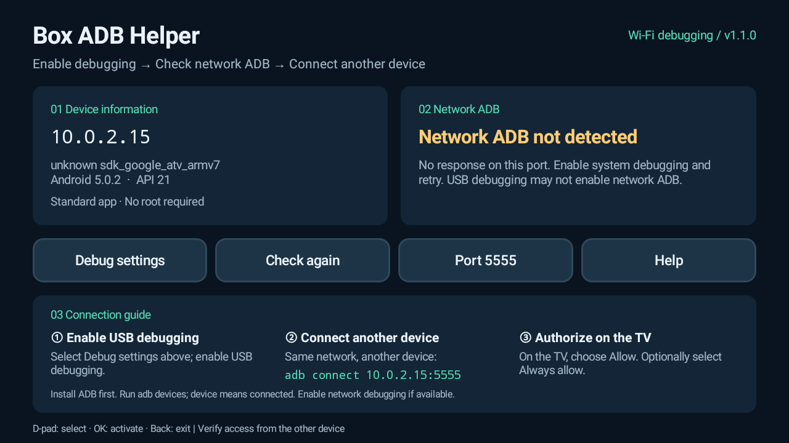

<div align="center">

# Box ADB Helper

**A small, remote-friendly ADB setup assistant for Android TV boxes.**

[](https://github.com/w1lli4m666-droid/box-adb-helper/releases/latest)
[](#requirements)
[](LICENSE)
[](https://github.com/w1lli4m666-droid/box-adb-helper/releases)

**English** · [简体中文](README.zh-CN.md)

[Download APK](https://github.com/w1lli4m666-droid/box-adb-helper/releases/latest) · [Report an issue](https://github.com/w1lli4m666-droid/box-adb-helper/issues)

</div>



## What it does

Install the APK **on your TV box**. It shows the box's IP address, opens debugging settings, checks for network ADB, and walks you through connecting from another device.

- Remote control support: use the D-pad, OK and Back keys.
- Device information and local IPv4 addresses, including Ethernet.
- Read-only ADB protocol detection, with an adjustable check port.
- A three-step connection guide with the box's actual `adb connect` command.
- English by default; the interface and launcher name switch automatically to Simplified Chinese on supported Simplified Chinese locales.
- No root, ads, analytics, third-party runtime dependencies or bundled native libraries.

The app assists with **system ADB**. A normal APK cannot enable system network ADB on firmware that does not expose it. USB debugging does not always enable TCP ADB.

## Requirements

| Component | Requirement |
| --- | --- |
| TV box | Android 5.0+ / API 21+ |
| Firmware | Network ADB support, or a working USB ADB connection for initial setup |
| Network | Both devices on a local network that permits communication |
| Other device | Android SDK Platform Tools on a computer, or a remote ADB client on Android |

The app is Java-only and works across ARM, ARM64 and x86. Node.js and npm are not required.

## Install and connect

1. Download the APK from [Releases](https://github.com/w1lli4m666-droid/box-adb-helper/releases/latest). Copy it to a USB drive or transfer it to the box, then install it with the box's file manager.
2. Open **Box ADB Helper**. Select **Debug settings** and enable USB debugging. Enable network debugging too, if your firmware offers it.
3. Connect the other device to the same local network. Install [Android SDK Platform Tools](https://developer.android.com/tools/releases/platform-tools), then run the command shown by the app:

   ```sh
   adb connect BOX_IP:5555
   ```

4. If the TV shows an RSA authorization prompt, choose **Allow**. You may select **Always allow** for your own computer.
5. Verify the connection:

   ```sh
   adb devices
   ```

   `BOX_IP:5555 device` means the connection is authorized. Already trusted devices may not show a new prompt.

If your firmware uses another port, change the check port in the app. This changes the displayed command and probe target; it does not change the system's ADB configuration.

### Troubleshooting

| Result | Next step |
| --- | --- |
| `adb` is not recognized | Use the full path to `adb.exe`, or add Platform Tools to your terminal's PATH. |
| `unauthorized` | Approve the authorization prompt on the TV. |
| `offline` | Disconnect and reconnect the device. |
| Connection refused or timeout | Check the IP, port, system debugging options, guest Wi-Fi, AP isolation and firewall. |
| App says **Port is reachable** | TCP responds, but no ADB handshake was received. An existing ADB connection can block new checks on some firmware. Check `adb devices` on the other device. |
| App never detects network ADB | Firmware may support USB debugging only. If the box has a working USB ADB device interface, initialize it with `adb tcpip 5555`. A USB socket alone does not guarantee support. |

The probe checks the box's own interfaces. A successful probe does not guarantee reachability from another device. Rebooting may reset network ADB on some firmware. Turn off debugging in system settings when finished.

## Language and app name

| Device locale | Interface and launcher name |
| --- | --- |
| English or another unsupported language | English · **Box ADB Helper** |
| Simplified Chinese: `zh-CN`, `zh-SG`, `zh-Hans` | 简体中文 · **盒子 ADB 助手** |
| Traditional Chinese | English · **Box ADB Helper** |

Language follows the device configuration automatically. There is no separate app language toggle. The Chinese first-step wording is: “点击上方调试设置按钮，开启USB调试”.

## Build from source

The lightweight build script runs on Windows and does not require Gradle.

Install JDK 17 or 21, plus these Android SDK packages:

```text
platforms;android-21
build-tools;35.0.0
```

Then run PowerShell from the repository root:

```powershell
.\build.ps1 -Sdk 'C:\path\to\Android\Sdk' -Jdk 'C:\path\to\jdk-21'
```

The APK is written to `build/box-adb-helper-1.1.1.apk`. The script uses aapt2, javac, D8, zipalign and apksigner, including v1 signing for Android 5.

By default, a local development key is created in `.signing/`. Builds made with a different key cannot overwrite an installed release; use the same signing key or uninstall the old app first. The original release key is kept privately and is not committed.

To use your own signing key, set `BOX_ADB_STORE_PASSWORD` and optionally `BOX_ADB_KEY_PASSWORD` in your environment, then pass `-Keystore` and `-KeyAlias` to `build.ps1`. Without password variables, the script uses the development password `android`.

## Validation

- Android TV 5.0.2 / API 21 / ARM emulator: English interface, installation and launch.
- Xiaomi MiBOX4, Android 6.0.1 / API 23: Simplified Chinese interface, installation and launch.
- Ten locale cases tested on both systems: English, French, Simplified Chinese and Traditional Chinese, including localized launcher labels and port formatting.
- Five protocol cases: AUTH, CNXN, invalid magic, unexpected AUTH type and closed port.
- All 51 visible strings covered in every resource configuration, with matching format arguments.
- APK signatures verified for Android 5.0 and newer.

See [tests/README.md](tests/README.md) for test instructions. Compatibility with other vendor firmware still depends on its debugging settings and ADB behavior.

## License

[MIT](LICENSE) © 2026 w1lli4m666-droid.

## Star History

[](https://www.star-history.com/#w1lli4m666-droid/box-adb-helper&Date)

The chart fills in as the repository receives stars.
