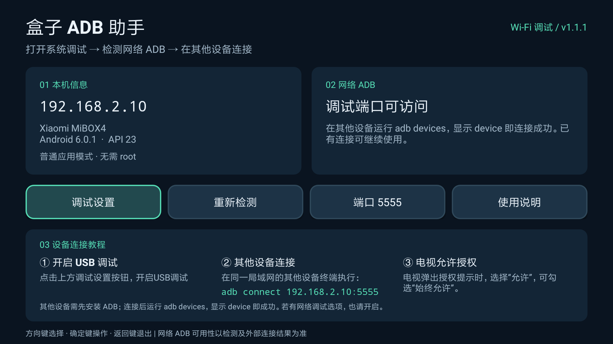

<div align="center">

# Box ADB Helper · 盒子 ADB 助手

**安装在电视盒子上、适配遥控器的轻量 ADB 调试设置助手。**

[](https://github.com/w1lli4m666-droid/box-adb-helper/releases/latest)
[](#使用条件)
[](LICENSE)
[](https://github.com/w1lli4m666-droid/box-adb-helper/releases)

[English](README.md) · **简体中文**

[下载 APK](https://github.com/w1lli4m666-droid/box-adb-helper/releases/latest) · [反馈问题](https://github.com/w1lli4m666-droid/box-adb-helper/issues)

</div>



## 应用功能

将 APK **安装在电视盒子上**。应用显示盒子的 IP 地址、打开调试设置、检测网络 ADB，并提供从其他设备连接的三步教程。

- 支持遥控器方向键、确定键和返回键。
- 显示设备信息及局域网 IPv4 地址，支持 Wi-Fi 和有线网络。
- 只读检测 ADB 协议，可以修改检测端口。
- 三步教程：开启 USB 调试 → 在其他设备终端连接 → 电视允许授权。
- 连接命令自动显示盒子的实际 IP 和所选端口。
- 默认英文；简体中文设备自动使用中文界面和中文桌面名称。
- 无需 root，无广告、统计 SDK、第三方运行依赖或原生库。

应用辅助使用**系统 ADB**。如果固件没有提供网络 ADB 支持，普通 APK 无法自行开启。USB 调试开关不一定同时开启网络 ADB。

## 使用条件

| 项目 | 要求 |
| --- | --- |
| 电视盒子 | Android 5.0+ / API 21+ |
| 固件 | 提供网络 ADB，或提供可用于初始化的 USB ADB 设备接口 |
| 网络 | 两台设备处于可互相访问的局域网 |
| 控制设备 | 电脑安装 Android SDK Platform Tools，安卓设备安装远程 ADB 客户端 |

应用使用纯 Java，兼容 ARM、ARM64 和 x86，不需要 Node.js 或 npm。

## 安装与连接

1. 从 [Releases](https://github.com/w1lli4m666-droid/box-adb-helper/releases/latest) 下载 APK，用 U 盘或其他方式传入盒子，再通过文件管理器安装。
2. 打开应用，点击上方 **调试设置** 按钮，开启 USB 调试。若固件提供网络调试选项，也请开启。
3. 其他设备与盒子连接到同一局域网。电脑安装 [Android SDK Platform Tools](https://developer.android.com/tools/releases/platform-tools)，在终端执行应用显示的命令：

   ```sh
   adb connect 盒子IP:5555
   ```

4. 电视出现 RSA 授权提示时，选择 **允许**；自己的电脑可以勾选 **始终允许**。
5. 检查连接状态：

   ```sh
   adb devices
   ```

   显示 `盒子IP:5555 device` 表示连接成功。已经授权的设备可能不再弹出授权提示。

如果固件使用其他端口，请修改应用的检测端口。该操作只修改检测目标与连接命令，不修改系统的 ADB 配置。

### 常见问题

| 现象 | 处理方法 |
| --- | --- |
| 提示 `adb` 不是内部或外部命令 | 使用 `adb.exe` 的完整路径，或将 Platform Tools 加入终端 PATH。 |
| 显示 `unauthorized` | 在电视上允许调试授权。 |
| 显示 `offline` | 断开设备后重新连接。 |
| 连接被拒绝或超时 | 检查 IP、端口、系统调试选项、访客网络、AP 隔离和防火墙。 |
| 应用显示“端口可连接” | TCP 可以连接，但没有收到 ADB 握手。部分固件已有调试连接时不响应新检测，请在其他设备运行 `adb devices` 确认。 |
| 始终检测不到网络 ADB | 固件可能只提供 USB 调试。如果盒子有可用的 USB ADB 设备接口，可先通过电脑执行 `adb tcpip 5555`。有 USB 插口不代表一定支持 USB ADB。 |

本机检测成功不代表其他设备一定能访问。部分固件重启后会关闭网络 ADB；调试完成后，可以在系统设置中关闭调试。

## 自动语言与应用名称

| 设备语言 | 界面及桌面名称 |
| --- | --- |
| 英文或其他未支持语言 | 英文 · **Box ADB Helper** |
| 简体中文：`zh-CN`、`zh-SG`、`zh-Hans` | 简体中文 · **盒子 ADB 助手** |
| 繁体中文 | 英文 · **Box ADB Helper** |

应用自动跟随设备语言，没有单独的语言切换开关。README 则通过顶部的 **English / 简体中文** 链接切换，仓库首页默认显示英文 README。

## 源码构建

构建脚本支持 Windows，不需要 Gradle。

安装 JDK 17 或 21，以及以下 Android SDK 包：

```text
platforms;android-21
build-tools;35.0.0
```

在仓库根目录用 PowerShell 执行：

```powershell
.\build.ps1 -Sdk 'C:\path\to\Android\Sdk' -Jdk 'C:\path\to\jdk-21'
```

APK 输出到 `build/box-adb-helper-1.1.1.apk`。脚本使用 aapt2、javac、D8、zipalign 和 apksigner，包含 Android 5 所需的 v1 签名。

默认在 `.signing/` 中生成本地开发密钥。不同密钥签名的 APK 无法覆盖安装现有 Release，请使用相同密钥或先卸载旧版本。正式发布沿用的原签名密钥保存在本地，不提交到仓库。

使用自己的密钥时，在环境中设置 `BOX_ADB_STORE_PASSWORD`，必要时设置 `BOX_ADB_KEY_PASSWORD`，并向 `build.ps1` 传入 `-Keystore` 和 `-KeyAlias`。未设置密码变量时，脚本使用开发密码 `android`。

## 已完成的验证

- Android TV 5.0.2 / API 21 / ARM 模拟器：英文界面、安装和启动。
- 小米 MiBOX4，Android 6.0.1 / API 23：简体中文界面、安装和启动。
- 两个系统各验证 10 个语言配置，覆盖英文、法文、简体中文和繁体中文，检查桌面名称、教程文字及端口格式。
- 5 项协议测试：AUTH、CNXN、错误 magic、非预期 AUTH 类型和关闭端口。
- 各语言资源覆盖全部 51 项界面字符串，格式参数一致。
- APK 签名验证通过，兼容 Android 5.0 及以上。

测试方法见 [tests/README.md](tests/README.md)。其他厂商固件的兼容性仍取决于其调试设置入口和 ADB 实现。

## 开源许可

[MIT](LICENSE) © 2026 w1lli4m666-droid。

## Star History

[](https://www.star-history.com/#w1lli4m666-droid/box-adb-helper&Date)

仓库获得 Star 后，图表会逐步出现数据。
